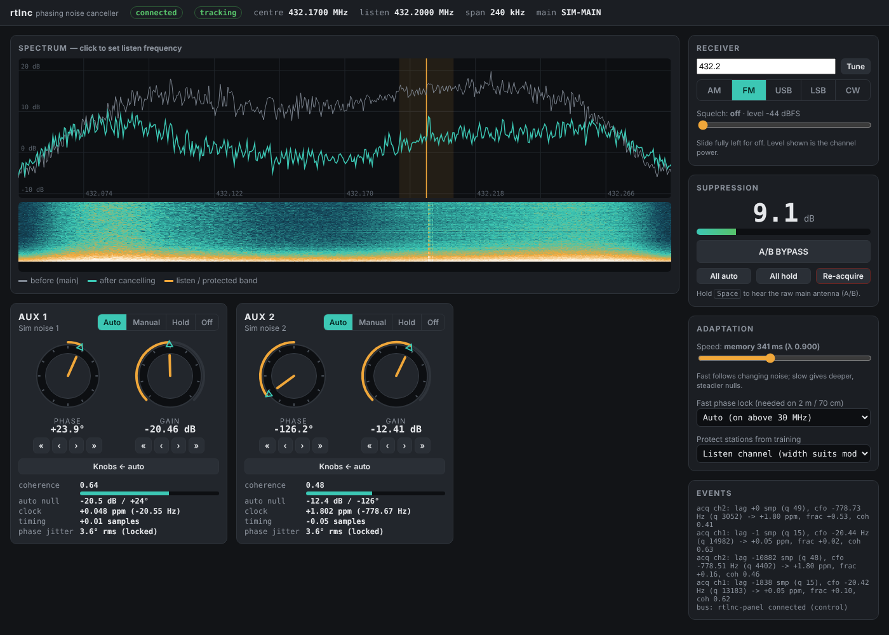
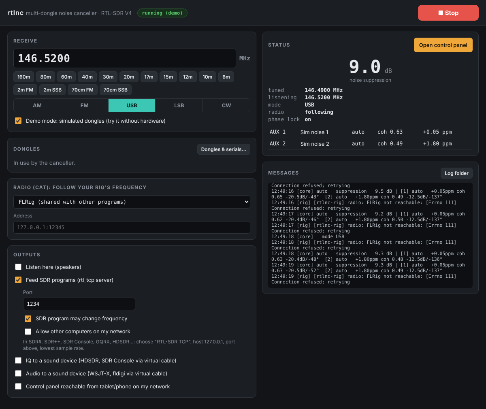
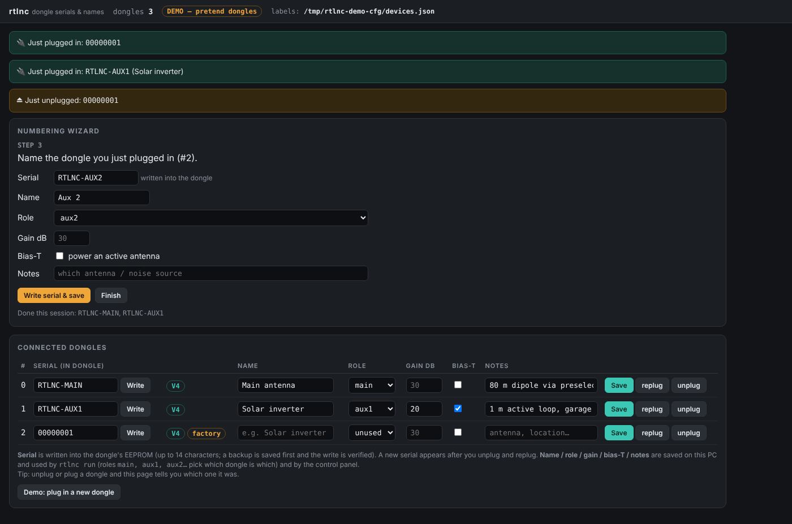

# rtlnc: multi-dongle phasing noise canceller for RTL-SDR Blog V4 (HF to 70 cm)

[](https://github.com/yankneck696/rtlnc/actions/workflows/windows.yml)
[](LICENSE)

**[⬇ Download the Windows installer](https://github.com/yankneck696/rtlnc/releases/latest)** ·
[Windows quick start](#1-windows-install-and-use-no-command-lines) ·
[Hardware](#2-hardware) · [CAT radios](#4-following-your-radio-cat) ·
[What to expect](#8-what-to-expect) · [Troubleshooting](#9-troubleshooting)



rtlnc is a software version of an MFJ-1026 / ANC-4 style noise canceller.
A hardware unit like those has one noise channel and one knob pair. This one
has N, one per extra dongle. Each aux dongle connects to a directional or
close-in antenna aimed at one noise source, and the canceller nulls up to N
sources at once. You listen in the app itself, in your favourite SDR program,
or in digital-mode software, and it can follow your rig's frequency by CAT.

* **RTL-SDR Blog V4 only.** Unmodified, no shared clock: each runs on its own
  TCXO, and the software measures and tracks the offsets.
* **0.5 to 450 MHz**: HF (through the V4's upconverter), 6 m, 2 m and 70 cm.
* **AM, FM, USB, LSB, CW.**
* **Windows app**: one installer, one window, no command prompts. All the
  parts also run as plain Python programs on Windows, Linux and macOS.

```
 main antenna ─► V4 #0 ┐
 aux 1 (src 1) ─► V4 #1 ┼─► core ══ IQ bus ══╦═► control panel    phasing knobs, spectrum, A/B
 aux N (src N) ─► V4 #N ┘  cancel + track     ╠═► rtl_tcp server   SDR#, SDR++, SDR Console, GQRX, HDSDR…
                                              ╠═► sound outputs    IQ / audio → virtual cable → WSJT-X, fldigi…
                                              ╚═◄ radio (CAT)      follows your rig's VFO and TX state
```

---

## 1. Windows: install and use (no command lines)

1. **Install.** Run `rtlnc-setup-0.3.0.exe`; Windows may show "unknown publisher"
   (More info → Run anyway). The RTL-SDR Blog V4 driver library is included.
2. **USB driver, once per dongle.** Plug in a V4, run
   [Zadig](https://zadig.akeo.ie): *Options → List All Devices* →
   "Bulk-In, Interface (Interface 0)" → **WinUSB** → *Install Driver*. Repeat
   for each dongle. If you already use SDR# with these dongles, this is
   already done.
3. **Start rtlnc** from the Start menu. The launcher window opens:
   * **Receive**: type a frequency or click a band button, then pick
     AM / FM / USB / LSB / CW. *Demo mode* lets you try everything with
     simulated dongles.
   * **Dongles**: shows what's plugged in. *Dongles & serials…* opens the
     editor and numbering wizard (see section 3). Do this once.
   * **Radio (CAT)**: choose your rig type and COM port to follow its VFO.
   * **Outputs**: speakers, SDR programs (rtl_tcp), sound-card IQ, audio
     for digital modes, and panel access from a tablet.
   * **▶ Start**, then **Open control panel** for the knobs.
4. Closing the launcher stops everything and releases the dongles.

Settings, names and logs live in `%APPDATA%\rtlnc\`.



### Getting the installer
* **Releases**: the [Releases page](https://github.com/yankneck696/rtlnc/releases)
  has `rtlnc-setup-<version>.exe` for every tagged version. GitHub Actions
  builds it automatically when a tag like `v0.3.0` is pushed.
* **Latest build**: every push to `main` is built and tested; open the latest
  run under [Actions](https://github.com/yankneck696/rtlnc/actions) and
  download *rtlnc-windows* from *Artifacts* (needs a GitHub login).

### Building the Windows app yourself
* **Your PC**: install Python 3.12 (64-bit, python.org) and optionally
  [Inno Setup 6](https://jrsoftware.org/isinfo.php), then double-click
  `packaging\build.bat`. You get `dist\rtlnc\rtlnc.exe` and, with Inno
  Setup, `dist\installer\rtlnc-setup-0.3.0.exe`.

The build downloads the official RTL-SDR Blog driver release (V1.3.2,
x64 `rtlsdr.dll` + libusb) and bundles it; see `packaging/THIRD-PARTY.txt`.

---

## 2. Hardware

| Item | Qty | Notes |
|---|---|---|
| **RTL-SDR Blog V4** | N + 1 | Unmodified; only V4s are accepted. One for main, one per noise source. |
| Powered USB 2.0/3.0 hub | 1 | Each V4 draws about 250 to 270 mA. Don't run 3 or more from laptop ports. |
| Main antenna | 1 | Your normal receive antenna for the band. |
| Aux antennas | N | One per noise source; see below. |
| Short USB extension leads | N + 1 | Space the dongles apart; they radiate a little. |
| Optional: band-pass / preselector | N + 1 | Same type on every channel, if used. |
| Optional: RX protection relay | N + 1 | Needed if you transmit nearby; see Safety. |

### Aux antennas: the "directional" part

How well this works depends far more on the aux antennas than on the software.
Each aux antenna should hear its own noise source much more strongly,
relative to the stations you want, than the main antenna does.

* **Local source you can locate** (a plasma TV, solar inverter, LED driver,
  SMPS wall-wart, the neighbour's charger): put a small active whip or a
  1 m loop close to it, or a long wire run toward it. Close proximity is
  the cheapest form of directivity.
* **Source in a known direction but out of reach** (a power-line arc down the
  street): use a small rotatable loop or a short Yagi/flag/EWE aimed at it.
  Point the loop's *maximum* at the source. On 2 m / 70 cm a small handheld
  Yagi aimed at the source works well.
* Use **one aux per independent source.** Two noise sources picked up by the
  same aux antenna count as one only if they always appear in the same ratio,
  which is rarely the case.
* Keep the aux antennas away from the main antenna's near field, at least a
  few metres if you can, so the aux doesn't simply become a copy of main.

### Clocks: do nothing

Leave the dongles stock, and don't set a ppm correction on any of them.
rtlnc relies on identical settings, which make each dongle's frequency
error exactly proportional to its own crystal error. Let the dongles **warm
up for 10 to 15 minutes** before serious use, especially on 2 m and 70 cm,
where drift is multiplied up.

### Safety: transmitting

This is a receive-only system. An RTL-SDR's input won't survive your own
transmitter. If you transmit:
* Never connect a dongle to a transmitting antenna without a T/R relay or
  sequencer that disconnects it, and preferably shorts it to ground, on PTT.
* Aux antennas within a few metres of your TX antenna also need protection:
  a PTT-keyed relay, or at least a commercial RF limiter.
* With CAT connected, rtlnc freezes the canceller while you transmit, so
  your own signal doesn't upset it. That is not protection for the dongles.

---

## 3. Give each dongle a unique serial and a name (once)

They all ship with the same serial (`00000001`). In the launcher click
**Dongles & serials…** (or run `rtlnc-devices web`) and follow the
**numbering wizard**: it has you plug them in one at a time. Put a sticker
with the serial on each dongle as you go, and give one the role **main**
and the others **aux1, aux2, …**



### `rtlnc-devices`: dongle serials and names
```bash
rtlnc-devices web                 # editor + numbering wizard: http://127.0.0.1:8074
rtlnc-devices web --demo          # try it with pretend dongles
rtlnc-devices list
rtlnc-devices set-serial 0 RTLNC-AUX1
rtlnc-devices name RTLNC-AUX1 --name "Solar inverter" --role aux1 --gain 20 --bias-tee on
rtlnc-devices info 0 | backup 0 | restore 0 FILE
```
Run it while the core is stopped; it needs the dongles to itself.
* **Serial**: written into the dongle's EEPROM, so it travels with the
  dongle. Up to 14 printable characters on a V4, enough for `RTLNC-AUX1` or
  `AUX1-INVERTER`.
  * Every write first saves the full EEPROM to `eeprom-backups/`, then reads
    the result back to verify it. `restore` puts a backup back.
  * Only the serial is changed. The manufacturer and product strings stay
    "RTLSDRBlog" / "Blog V4", because the driver uses them to switch on the
    V4's HF upconverter.
  * A new serial shows up after you **unplug and replug**.
* **Numbering wizard**: new dongles all report the same serial, so software
  can't tell them apart. The wizard has you reduce to one un-numbered
  dongle, name it, replug it, then plug in the next. Serials and roles are
  suggested (`RTLNC-MAIN`/main, `RTLNC-AUX1`/aux1, …).
* **Name, role, gain, bias-T, notes**: saved on this PC in `devices.json`
  (`~/.config/rtlnc/`, `%APPDATA%\rtlnc\` on Windows), keyed by serial.
  * `rtlnc run` with no `--devices` opens the `main` dongle, then `aux1`,
    `aux2` … with their saved gain and bias-tee.
  * `--devices` also accepts names or roles (`--devices main "Solar inverter"`).
  * The control panel labels each strip with its dongle's name.
* **Which dongle is that?** Unplug or plug one and the page says which it was.


---

## 4. Following your radio (CAT)

In the launcher, choose the rig type and COM port under **Radio (CAT)**.
From the command line:

```bash
rtlnc-rig --list-ports
rtlnc-rig --cat icom --port COM5 --civ IC-7300      # or --civ 0x94
rtlnc-rig --cat yaesu --port COM7 --baud 38400      # FT-991A, FTdx10/101, FT-710, FT-891…
rtlnc-rig --cat kenwood --port COM3 --baud 115200   # TS-590, TS-890, TS-2000…
rtlnc-rig --cat elecraft --port COM4                # K3/K3S, K4, KX2/KX3
rtlnc-rig --cat flrig                               # through FLRig (port 12345)
rtlnc-rig --cat rigctld --addr 127.0.0.1:4532       # through Hamlib rigctld
```
* **Frequency**: the radio's VFO becomes the listen frequency, on any band
  0.5 to 450 MHz. The dongles retune when you leave the 240 kHz span, and
  the protected band and demodulator move with you.
* **TX state**: while you transmit, the canceller holds its weights,
  adaptation and clock tracking pause, and audio outputs mute. It resumes on
  receive. The TX state comes from Icom `1C 00`, Yaesu `TX;`, Elecraft `TQ;`
  and the Kenwood `IF;` status. rtlnc never sends Kenwood's `TX;`, because
  on Kenwood that command keys the transmitter.
* **Read-only**: rtlnc never changes anything on the radio.
* **Sharing the port**: a COM port can only be opened by one program. If
  WSJT-X or your logger also uses CAT, run **FLRig** or **rigctld**, point
  them and rtlnc at it, and choose that type here.
* Icom: set *CI-V USB Echo Back* to OFF (if available) and match the CI-V
  address and baud rate in the radio's menu.

---

## 5. Command-line use (any OS)

```bash
pip install -e .                       # numpy, scipy, pyrtlsdr, sounddevice, pyserial
rtlnc-app                              # the launcher (opens in your browser on Linux/macOS)

rtlnc run --sim 2 --freq 146.52e6 --mode fm          # simulator, no hardware
rtlnc-devices web                                    # serials + roles, once
rtlnc check --freq 3.750e6                           # 20 s health check
rtlnc run   --freq 432.1e6 --mode usb                # main + aux1, aux2… from the saved roles
rtlnc-panel                                          # control panel: http://127.0.0.1:8073
```
The librtlsdr on your system must support the V4 (the RTL-SDR Blog driver,
or a current osmocom build).

Core options: `--mode am|fm|usb|lsb|cw`, `--squelch -60` (dBFS),
`--fast-phase auto|on|off`, `--exclude mode|auto|<Hz>|0`, `--gain` (one value
or one per dongle), `--wav`, `--iq-out`, `--bus` (add-on address).
Console commands while it runs: `ab`, `auto`, `hold`, `bypass`, `g 1 -6`,
`p 1 120`, `off 2`, `listen 146.52e6`, `mode fm`, `sq -60`, `fast on`, `x auto`, `q`.

### The add-ons (separate programs; the launcher starts them for you)

### `rtlnc-panel`: control panel (phasing knobs)
```bash
rtlnc-panel                                    # http://127.0.0.1:8073
rtlnc-panel --http 0.0.0.0:8073 --token s3cret # tablet/phone on the LAN: http://<pc>:8073/?t=s3cret
```
* **One strip per aux dongle** with **PHASE** and **GAIN** knobs. Drag up or
  down, use the mouse wheel, or the ‹ › « » buttons. Hold *Shift* for fine
  control, or double-click the value to type a number.
  A teal ghost marker shows the auto solution, so you can see where the
  null is.
* **Auto / Manual / Hold / Off** per channel. Touching a knob switches that
  channel to Manual *from exactly where Auto was*: the knobs scale and
  rotate the channel's own multi-tap filter, so taking over is seamless and
  you trim from the best null. The other Auto channels keep re-solving
  around your setting (a constrained joint solution). *Knobs ← auto* resets
  the knobs to the current auto null.
* Clock tracking keeps running underneath, so Manual and Hold settings
  **don't drift** even though the dongles have independent clocks.
* **Receiver**: type a frequency, choose AM / FM / USB / LSB / CW, and set
  the squelch (shows the channel level).
* **Spectrum and waterfall**, before (grey) and after (teal); click to set
  the listen frequency. A **suppression meter**, **A/B bypass** (button, or
  hold *Space*), **adaptation speed**, and **station protection** (Auto, or a
  fixed band around the listen frequency).
* Per-channel **coherence**: how much of the main antenna's noise this aux
  hears. Re-aim the aux antenna if it stays below about 0.1. Also shown:
  **clock offset**, **timing** and, on 2 m / 70 cm, the **phase jitter** the
  fast phase lock is removing.

Typical null depth against knob error (simulated, single source): 1° → −0.2 dB,
3° → −1.6 dB, 10° → −5 dB, 1 dB gain → −3 dB. Fine trimming matters.

### `rtlnc-tcp`: add-on for SDR programs
```bash
rtlnc-tcp                      # serves rtl_tcp on 0.0.0.0:1234
```
In your SDR program choose the **RTL-SDR (TCP)** / rtl_tcp source and enter
host `127.0.0.1` (or this PC's address) and port `1234`. That's
SDR# "RTL-SDR TCP", SDR++ "RTL-TCP", GQRX device string `rtl_tcp=127.0.0.1:1234`,
SDR Console "RTL-SDR (TCP)", HDSDR with ExtIO_RTL_TCP, CubicSDR via SoapyRTLTCP,
or OpenWebRX `rtl_tcp`.
* Tuning the program's centre frequency retunes the dongles (`--no-tune` to
  stop that, for example when `rtlnc-rig` follows the radio).
* Pick the **lowest sample rate** offered (0.25 MS/s). Higher rates work
  (rtlnc resamples), but only about 240 kHz contains signal.
* The program's gain slider becomes a digital output gain; "auto gain"
  gives a slow AGC. The dongles' real gain stays with the core.
* rtl_tcp carries 8-bit samples, so a little dynamic range is lost in
  transit. For full precision use `rtlnc-sound` (32-bit float) instead.

### `rtlnc-sound`: sound card IQ and audio
```bash
rtlnc-sound --list
rtlnc-sound --iq-device "CABLE Input" --iq-rate 192000     # IQ for HDSDR / SDR Console / Quisk
rtlnc-sound --audio-device "CABLE-B Input" --mode usb      # audio for WSJT-X / JS8Call / fldigi
```
Uses a virtual cable: VB-Audio Cable (Windows), BlackHole (macOS), or a
PipeWire/PulseAudio null sink (Linux). For IQ, set the program's LO to the
core's centre frequency (printed). The audio follows the listen frequency.

### The IQ bus (for your own tools)
A plain TCP stream of frames (`RNC1` + JSON header + complex64 IQ) on
`127.0.0.1:7355`, with newline-delimited JSON commands going back to the
core (`listen`, `tune`, `demod`, `squelch`, `chan`, `mode`, `ptt`…). It is
documented at the top of `rtlnc/bus.py`, and GNU Radio or a short script can
use it.

---

## 6. Typical setups

| You want | In the launcher tick / choose |
|---|---|
| Listen with less noise | Listen here (speakers) |
| Use your SDR program | Feed SDR programs (rtl_tcp) |
| FT8 / JS8 / fldigi with less noise | Audio to a sound device (virtual cable) + Radio (CAT) |
| Follow your transceiver around the bands | Radio (CAT) |
| Hand-tune nulls from the couch | Control panel reachable from tablet/phone |

## 7. How it works

**Acquisition (about 1 s at start-up and after a retune).** The noise you want
to cancel reaches both antennas, so the noise itself is the shared reference
signal. No calibration source is needed.
1. *Start offset*: USB streams start milliseconds apart. rtlnc cross-correlates
   the |x|² envelopes, which don't depend on frequency offset, so this works
   before the offset is known. Impulsive noise gives sharp peaks.
2. *Frequency offset*: everything in a V4 (tuner, HF upconverter, ADC) runs
   from its own 28.8 MHz TCXO, so a crystal error ε gives a frequency error
   of about −f·ε. That is about 90 Hz at 28 MHz, 400 Hz at 2 m and 1.3 kHz at
   70 cm for a 3 ppm difference. rtlnc correlates short sub-blocks at the
   found lag and FFTs the result.
3. *Sample-rate offset*: the same ε, so rate = 1 − cfo/f_tune. One measurement
   gives both corrections.

**Tracking (continuous).**
* Each aux stream is resampled onto main's time base with a 32-tap, 4096-phase
  sinc interpolator. In-band error is about −70 dB, below the 8-bit ADC
  floor.
* A frequency-locked loop is driven by the block-to-block rotation of each
  channel's canceller weights. Any leftover frequency offset makes the
  optimal weight spin at exactly that rate. Unlike cross-correlation, this
  measurement isn't disturbed when the mix of noise sources changes, for
  example when a buzz turns on and off.
* **Fast phase lock (2 m / 70 cm)**: each dongle's crystal phase noise is
  multiplied up with the frequency, so at 435 MHz the relative phase jitters
  far faster than at 7 MHz. Above 30 MHz a phase-locked loop on each aux
  stream updates every ~2 ms, before training and cancelling. It locks to
  the unconstrained auto solution, so hand-set knobs keep their meaning.
* A timing PI loop keeps the cross-correlation peak centred on the middle tap.
* Slip repair: if a USB buffer is dropped, coherence collapses. rtlnc
  re-searches a ±32k-sample window and realigns only that channel, without
  stopping the audio.

**Cancellation.**
`y[n] = main[n−D] − Σ_k Σ_j w[k,j]·aux_k[n−j]`, with K taps per aux channel
(default 5). All aux channels are solved jointly with exponentially weighted
least squares, so N aux channels give N independent nulls. Training leaves
out ±4 kHz around the listen frequency (`--exclude`). The canceller learns
the noise coupling from the rest of the 240 kHz span, so a strong station
that also leaks into the aux antennas isn't cancelled along with the noise.
In simulation this protection is worth about 18 dB in the strong-station
case (22 dB improvement vs 4 dB without it).

## 8. What to expect

These are simulated results, from `pytest tests`: 8-bit quantisation,
independent ±3 ppm clocks, oscillator phase noise, random start offsets,
and three different noise types.

| Aux dongles / noise sources | SINR improvement, HF (7 MHz, 2.4 kHz SSB channel) |
|---|---|
| 1 / 1 | ≈ 24 dB |
| 2 / 2 | ≈ 20 dB |
| 3 / 3 | ≈ 18 dB |

| Band (2 aux / 2 sources) | Fast phase lock off | Fast phase lock on (default above 30 MHz) |
|---|---|---|
| 40 m (7.1 MHz) | 20 dB | 20 dB |
| 2 m (145 MHz) | 13 dB | 20 dB |
| 70 cm (435 MHz) | 6 dB | 18 dB |

For 2 m and 70 cm the simulator's phase-noise level is a **guess**: it
scales the HF value by frequency. Real V4s may do better or worse, so treat
the VHF/UHF figures as the least certain in this README. With ideal
shared clocks the HF result is the same within 0.2 dB, so clock tracking is
not what limits HF performance.

Expect less in the field. What sets the limit there:
* **Physics**: one aux can remove one *compact* source. A noise source spread
  out along a long power line looks like several sources.
* **Desired-signal leakage** into the aux antennas: aim them better.
* **8-bit dynamic range**: a very strong local source near an aux antenna can
  overload it; lower that dongle's gain.
* Every dongle must hear the noise above its own noise floor; check the
  coherence value.

None of this has been measured on real dongles yet.

## 9. Troubleshooting

* **"No RTL-SDR found"** (Windows): install WinUSB with Zadig (section 1).
  Windows Update sometimes puts the TV driver back; re-run Zadig.
* **"not V4 / unsupported"**: rtlnc only works with RTL-SDR Blog V4 dongles.
* `** WEAK **` at acquisition, or coherence < 0.1: the aux isn't hearing the
  noise that main hears, or the noise was absent at start-up. Re-aim the
  aux, then press *Re-acquire* in the panel.
* **Radio: "can't reach radio"**: wrong COM port or baud rate, CAT not
  enabled in the radio's menu, another program holds the port (use FLRig or
  rigctld), or on Icom the wrong CI-V address.
* Audio drops or `USB overflows`: too many dongles on one USB controller, or
  a slow PC. Use a better hub.
* A strong station gets weaker when cancelling: set *Protect stations* to
  Auto or widen it, or Hold the channels once it sounds best.
* An SDR program shows signal only in the middle: expected. Only about
  240 kHz carries signal; use the lowest rate the program offers.
* Messages and logs: the launcher's *Log folder* button.

## Status and contributions

rtlnc has been developed and tested against a detailed simulator (independent
crystal clocks, phase noise, 8-bit ADC, USB dropouts) and fake CAT radios.
**It has not been verified on real V4 hardware yet.** Reports from real
setups (`rtlnc check` output, panel screenshots, what worked and what didn't)
are very welcome as [issues](https://github.com/yankneck696/rtlnc/issues).

Run the tests with `pip install -e .[test] && pytest -q tests`.

## License

GPL-3.0-or-later ([LICENSE](LICENSE)). The Windows package bundles the
RTL-SDR Blog driver (GPL-2.0-or-later) and libusb (LGPL-2.1); see
[packaging/THIRD-PARTY.txt](packaging/THIRD-PARTY.txt).

## Files

```
rtlnc/launcher.py + launcher.html   Windows/desktop launcher window
rtlnc/winapp.py        single entry point for rtlnc.exe (launcher + hidden sub-programs)
rtlnc/app.py           core: dongles → canceller → bus, console
rtlnc/pipeline.py      acquisition, FLL, fast phase lock hand-off, timing, slip repair
rtlnc/canceller.py     joint LS canceller, per-channel auto/manual/hold/off, fast PLL
rtlnc/demod.py         AM / FM / USB / LSB / CW, squelch
rtlnc/cat.py           CAT: Icom CI-V, Yaesu, Kenwood, Elecraft, FLRig, rigctld
rtlnc/capture.py       V4-only check, pyrtlsdr async readers
rtlnc/sync.py          envelope lag, CFO estimate, fine lag
rtlnc/resample.py      fractional resampler (clock correction)
rtlnc/rational.py      streaming rational resampler (output rates)
rtlnc/bus.py           IQ bus server/client
rtlnc/eeprom.py        EEPROM decode/encode, safe serial write with backup + verify
rtlnc/devconfig.py     names / roles / gains per serial (devices.json)
rtlnc/sim.py           independent-clock multi-dongle simulator
rtlnc/addons/          panel, tcp (rtl_tcp), sound, rig (CAT follow), devices (editor)
packaging/             PyInstaller spec, build.bat, DLL fetch, Inno Setup, icon
.github/workflows/     Windows build + installer on GitHub Actions
tests/                 unit + end-to-end tests (simulator, fake radios; no hardware needed)
```
